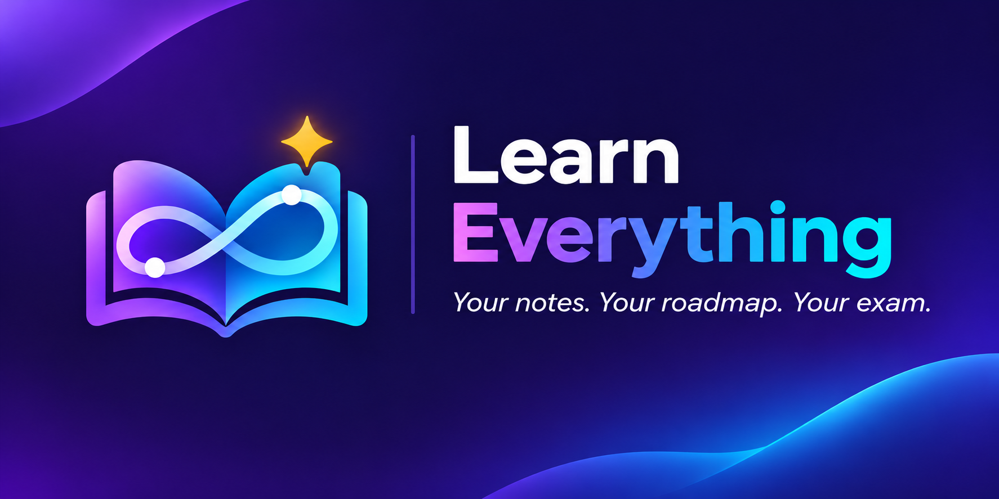

<div align="center">



**Convierte tus propios apuntes en un plan de examen, un tutor personal y un hábito diario.**

Un plugin para [Claude Code](https://claude.com/claude-code)

[](CHANGELOG.md)
[](LICENSE)
[](https://www.python.org/)
[](https://github.com/DiegoRecover8/learn-everything/actions/workflows/tests.yml)

🇬🇧 [English](README.md) · 🇪🇸 **Español**

</div>

---

Le das tus PDF, diapositivas, documentos de Word y fotos de tus apuntes **una sola vez**. Crea un roadmap con todo lo que entra en el examen, planifica cada día hasta la fecha del examen, te explica cada tema a partir de tu propio material, te pregunta, te vuelve a preguntar justo antes de que se te olvide y te mantiene constante con rachas, XP y logros, al estilo de Duolingo.

<!-- VÍDEO DEMO: en github.com, edita este archivo y arrastra aquí el .mp4; GitHub lo sube e inserta un enlace que se reproduce en la página. Ponlo en lugar de este comentario. -->

## ✨ Qué hace

| | |
|---|---|
| 📄 **Lee tu material una sola vez** | PDF, Word, PowerPoint, fotos y texto. Cada archivo se convierte en apuntes fieles y se reconoce por su contenido, así que nunca se lee dos veces. |
| 🗺️ **Roadmap y mapa de contenidos** | Unidades y temas con sus conceptos clave, ponderados según lo que cuenta cada uno en el examen. |
| 📅 **Un plan hasta el examen** | Temas por día según la fecha del examen y tus minutos diarios. Los últimos días se reservan para repasar y, si fallas un día, se replanifica solo. La fecha es opcional. |
| 🧑‍🏫 **Explica y después pregunta** | Explicaciones cortas e interactivas sacadas de tus apuntes y, después, test, verdadero o falso, rellenar huecos, respuesta corta, desarrollo, ordenar y emparejar. |
| 🔁 **Repetición espaciada** | SM-2 te vuelve a preguntar cada cosa en el momento justo, y siempre antes del examen. |
| 📝 **Simulacros** | Sin correcciones hasta el final, con nota y desglose por tema. |
| 🔥 **Rachas, XP, niveles y 16 logros** | Y protectores de racha, para que un mal día no te la borre. |
| 📊 **Dashboard** | Una página HTML local: cuenta atrás, mapa de contenidos, roadmap, puntos fuertes y débiles, actividad, aciertos y repasos pendientes. Modo claro y oscuro. |
| 👋 **Un resumen cada vez que vuelves** | Qué viste la última vez, en qué vas fuerte, qué mejorar y el plan de hoy. |
| 🌍 **En cualquier idioma** | Estudia en tu idioma. El dashboard y las líneas de estado están en español, inglés, francés, alemán, italiano y portugués. |
| 🔒 **Privado** | Todo se queda en tu ordenador, en archivos normales. |

## 🚀 Instalación

Necesitas [Claude Code](https://claude.com/claude-code) y Python 3.8 o superior (ya viene en macOS y en la mayoría de Linux). Nada más.

```bash
claude plugin marketplace add DiegoRecover8/learn-everything
claude plugin install learn@learn-everything
```

Reinicia Claude Code y escribe `/learn`.

Para probarlo sin instalar, clona el repositorio y abre Claude Code con `claude --plugin-dir /ruta/a/learn-everything`.

## ⚡ Inicio rápido

```
/learn:setup     responde unas preguntas con opciones: idioma, nombre, nivel, examen, fecha y tiempo diario
/learn:add       arrastra tus archivos o una carpeta a la ventana, o deja que busque tus archivos recientes
/learn           la sesión de hoy
```

A partir de ahí basta con `/learn` una vez al día. Cada vez que abras Claude Code verás cómo vas:

```
[Learn Everything] 📚 Física II — faltan 24 días para el examen
[Learn Everything] 🔥 Racha: 8 días · ⭐ Nivel 8 (3543 XP)
[Learn Everything] 🗺️ Progreso: 11/15 temas estudiados · 3 dominados
[Learn Everything] 📖 Última sesión (ayer): Ley de Gauss · 8/10 aciertos
[Learn Everything] 💪 Fuerte en: Ley de Coulomb · 🎯 A mejorar: Potencial eléctrico
[Learn Everything] 📅 Hoy: 14 repasos + 1 tema nuevo — ejecuta /learn
```

## 🧭 Comandos

Escribe `/learn` y Claude Code te los muestra todos.

| Comando | Qué hace |
|---|---|
| `/learn` | Hace lo que toque hoy: setup, material o la sesión de estudio |
| `/learn:setup` | Crea un examen, o cambia la fecha, el tiempo diario, el idioma o el nivel |
| `/learn:add` | Carga material y crea o amplía el roadmap |
| `/learn:exam` | Simulacro de examen |
| `/learn:dashboard` | Genera y abre el dashboard |
| `/learn:data` | Cambiar de examen, copia de seguridad, exportar, restaurar, borrar |

También puedes decirlo con tus palabras: "pregúntame de la unidad 2", "tengo diapositivas nuevas", "¿cómo voy?".

## 📎 Cómo añadir tu material

No hace falta escribir rutas:

- **Arrastra** un archivo o una carpeta entera a la ventana de Claude Code; su ruta se pega sola.
- **Deja que busque**: `/learn:add` puede listar tus PDF, Word, diapositivas e imágenes recientes de Descargas, Escritorio y Documentos, y eliges por número.
- **Pega** fotos de tus apuntes (Ctrl+V) o texto directamente en el chat.

| Tipo | Notas |
|---|---|
| PDF | Los documentos largos se leen por rangos de páginas |
| DOCX, PPTX | Texto, tablas, notas del orador e imágenes incrustadas |
| JPG, PNG, WEBP, GIF | Fotos de apuntes, pizarras o páginas de libro |
| TXT, MD, CSV | Se leen tal cual |

Los PDF escaneados y las fotos los lee Claude directamente, así que no hace falta ninguna herramienta de OCR. La primera lectura de un documento largo tarda unos minutos; solo ocurre una vez.

## ⚙️ Cómo funciona

**Una sesión** tiene tres partes: repasar las preguntas que vencen hoy, aprender el siguiente tema del roadmap y practicarlo con preguntas nuevas. Empieza con un breve resumen y termina con tu resultado, el XP ganado, tu racha y lo que toca mañana.

**El plan.** Con fecha de examen, los temas pendientes se reparten entre los días que quedan, reservando aproximadamente la última quinta parte (mínimo dos días) para repaso y simulacros. Sin fecha, va a ritmo constante según tus minutos diarios. Si el plan exige más al día de lo que cabe en tu tiempo, te avisa.

**Los repasos.** Cada respuesta se puntúa de 0 a 5. Una buena respuesta aleja la pregunta (1 día, 6 días y cada vez más); una mala la trae de vuelta mañana. Cuando se acerca el examen, los intervalos se acortan para que toda pregunta se vuelva a ver a tiempo.

**El estado de un tema** va de sin empezar a aprendiendo, repasando y dominado, según cómo respondas a sus preguntas. Puede volver a bajar si empiezas a fallarlas.

**La racha.** Un día cuenta cuando registras al menos una sesión. Cada 7 días seguidos ganas un protector de racha (máximo 2), que cubre automáticamente un día perdido.

**El XP.** Hasta 10 por respuesta correcta, 2 por una fallada, 20 por tema estudiado, 30 por cumplir la meta diaria y 50 por simulacro.

**Gasta pocos tokens.** Tu material se lee una vez y se convierte en apuntes. Después, cada sesión lee solo las páginas del tema que está enseñando, y los comandos extra del plugin no cuestan nada hasta que los usas.

**Quién hace qué.** Claude enseña y corrige; un pequeño script de Python lleva la contabilidad y los cálculos, de modo que rachas, calendarios y logros se calculan siempre igual.

## 🔒 Tus datos

Todo se guarda como archivos normales en `~/learn-everything/` (define `LEARN_EVERYTHING_HOME` para usar otra carpeta):

```
profile.json            tú: XP, racha y logros (común a todos los exámenes)
<examen>/exam.json      ajustes del examen y roadmap
<examen>/cards.json     preguntas y su calendario de repaso
<examen>/log.jsonl      una línea por sesión
<examen>/sources/       apuntes creados a partir de tu material
<examen>/dashboard.html el dashboard
```

- Tus archivos originales nunca se modifican ni se copian; solo se guardan los apuntes creados a partir de ellos.
- Antes de cada cambio se hace una copia de seguridad (se conservan las 10 últimas en `.backups/`).
- `/learn:data` exporta un examen a un zip, lo restaura en otro ordenador o lo borra. Los exámenes borrados van a `.trash/`, así que un error se puede deshacer.
- Para eliminarlo todo, borra la carpeta `~/learn-everything/`.

## ❓ Preguntas frecuentes

<details>
<summary><b>¿Dónde funciona?</b></summary>

En Claude Code: la terminal, la app de escritorio y las extensiones para IDE. Necesita Python en el mismo ordenador y una carpeta donde guardar tu progreso, así que no funciona en el chat normal de claude.ai. Cowork admite plugins, pero este todavía no se ha probado allí.
</details>

<details>
<summary><b>¿Puedo preparar varios exámenes a la vez?</b></summary>

Sí. Cada examen tiene su roadmap, sus preguntas y su plan; el XP, la racha y los logros son comunes. Cambia de examen con `/learn:data`.
</details>

<details>
<summary><b>He actualizado desde la 0.1 y los comandos han cambiado.</b></summary>

Desde la 0.2.0 el plugin se llama `learn`, así que sus comandos son `/learn:setup`, `/learn:add`, etc. Reinstálalo una vez:

```bash
claude plugin uninstall learn-everything@learn-everything
claude plugin marketplace update learn-everything
claude plugin install learn@learn-everything
```

Tus datos de estudio no se tocan.
</details>

<details>
<summary><b>¿Cuánto consume?</b></summary>

Lo costoso es leer el material largo la primera vez, y ocurre una vez por archivo. Las sesiones diarias leen solo los apuntes del tema que estudias y las preguntas que tocan hoy.
</details>

## 🤝 Contribuir

Las contribuciones son bienvenidas, sobre todo **nuevos idiomas** (un archivo JSON en [`scripts/i18n/`](scripts/i18n)), avisos de errores e ideas. Lee [CONTRIBUTING.md](CONTRIBUTING.md) para empezar; todas las personas que participan siguen el [Código de conducta](CODE_OF_CONDUCT.md). Los problemas de seguridad se comunican según [SECURITY.md](SECURITY.md).

## 📁 Estructura del proyecto

```
.claude-plugin/        manifiestos del plugin y del marketplace
skills/learn/          /learn: la sesión diaria y las guías para explicar y preguntar
skills/<acción>/       /learn:setup, /learn:add, /learn:exam, /learn:dashboard, /learn:data
scripts/le.py          el motor de datos (solo librería estándar de Python)
scripts/i18n/          traducciones del dashboard y de las líneas de estado
scripts/dashboard_template.html
hooks/hooks.json       las líneas de estado al abrir Claude Code
tests/test_le.py       python3 -m unittest discover -s tests
```

## 🙏 Créditos

Learn Everything parte de ideas de dos proyectos con licencia MIT:

- [learn-anything](https://github.com/ChenChenyaqi/learn-anything), de ChenChenyaqi: el mapa de conocimiento, la estructura de las explicaciones y los tipos de pregunta.
- [Fluent](https://github.com/m98/fluent), de m98: la forma de plugin de Claude Code, el estado al iniciar sesión, la racha y la repetición espaciada SM-2.

## 📄 Licencia

[MIT](LICENSE)
