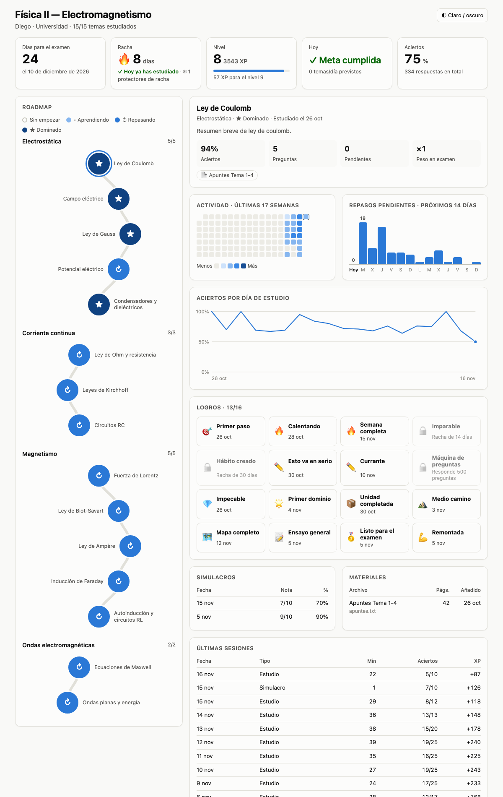

# Learn Everything

[English](README.md) · **Español**

Un plugin de Claude Code que te prepara para un examen a partir de **tu propio material**. Le das tus apuntes, diapositivas y fotos una sola vez; crea un roadmap, planifica cada día hasta el examen, te explica cada tema, te pregunta y te mantiene constante con rachas, XP y logros.



## Qué hace

- **Lee tu material una sola vez.** PDF, Word, PowerPoint, fotos de apuntes a mano, texto. Cada archivo se convierte en apuntes de estudio y se recuerda por su contenido, así que nunca se lee dos veces.
- **Crea un roadmap** de unidades y temas a partir de ese material, ponderado según lo que pesa cada tema en el examen.
- **Planifica tus días.** Dile la fecha del examen y cuántos minutos tienes al día. Calcula cuántos temas tocan cada día, reserva los últimos días para repasar y se replanifica solo si fallas un día. La fecha del examen es opcional.
- **Explica y después pregunta.** Explicaciones cortas e interactivas sacadas de tus apuntes, seguidas de preguntas: test, verdadero o falso, rellenar huecos, respuesta corta, preguntas de desarrollo, ordenar y emparejar.
- **Te vuelve a preguntar en el momento justo** con repetición espaciada (SM-2), siempre antes del examen.
- **Simulacros** sin correcciones hasta el final, con nota y desglose por tema.
- **Racha, XP, niveles y 16 logros.**
- **Un dashboard** en un único archivo HTML: mapa del roadmap, cuenta atrás, actividad, aciertos y repasos pendientes.

Todo se queda en tu ordenador.

## Instalación

Necesitas [Claude Code](https://claude.com/claude-code) y Python 3.8 o superior. No hay que instalar nada más.

```bash
claude plugin marketplace add DiegoRecover8/learn-everything
claude plugin install learn-everything@learn-everything
```

Reinicia Claude Code y escribe `/learn`.

Para probarlo sin instalar, clona el repositorio y ejecuta `claude --plugin-dir /ruta/a/learn-everything`.

## Inicio rápido

```
/learn setup                    tu nombre, nivel, examen, fecha y minutos al día
/learn add ~/Documentos/fisica  un archivo, varios o una carpeta entera
/learn                          la sesión de hoy
```

A partir de ahí basta con `/learn` cada día. Al abrir Claude Code verás cómo vas:

```
[Learn Everything] 📚 Física II — faltan 24 días para el examen
[Learn Everything] 🔥 Racha: 8 días · ⭐ Nivel 8
[Learn Everything] 📅 Hoy: 14 repasos + 1 tema nuevo — ejecuta /learn
```

## Comandos

Hay un único comando. Lo que escribas detrás decide la acción.

| Comando | Qué hace |
|---|---|
| `/learn` | Hace lo que toque hoy: setup, añadir material o la sesión de estudio |
| `/learn setup` | Crea un examen nuevo, o cambia tu perfil o los ajustes del examen |
| `/learn add <ruta>` | Carga material y crea o amplía el roadmap |
| `/learn exam` | Simulacro de examen |
| `/learn dashboard` | Genera y abre el dashboard |
| `/learn data` | Listar o cambiar de examen, copia de seguridad, exportar, restaurar, borrar |

También puedes decirlo con tus palabras: "pregúntame de la unidad 2", "tengo diapositivas nuevas", "¿cómo voy?".

Si otro plugin también tiene un comando `/learn`, usa el nombre completo: `/learn-everything:learn`.

## Cómo funciona

**Una sesión** tiene tres partes: repasar las preguntas que vencen hoy, aprender el siguiente tema del roadmap y practicarlo con preguntas nuevas. Al terminar ves tu resultado, el XP ganado, tu racha y qué toca mañana.

**El plan.** Con fecha de examen, los temas pendientes se reparten entre los días que quedan, reservando aproximadamente la última quinta parte (mínimo dos días) para repaso y simulacros. Sin fecha, va a ritmo constante según tus minutos diarios. Si el plan exige más al día de lo que cabe en tu tiempo, te avisa.

**Los repasos.** Cada respuesta se puntúa de 0 a 5. Una buena respuesta aleja la pregunta (1 día, 6 días y cada vez más); una mala la trae de vuelta mañana. Cuando se acerca el examen, los intervalos se acortan para que toda pregunta se vuelva a ver a tiempo.

**El estado de un tema** va de sin empezar a aprendiendo, repasando y dominado, según cómo respondas a sus preguntas. Puede volver a bajar si empiezas a fallarlas.

**La racha.** Un día cuenta cuando registras al menos una sesión. Cada 7 días seguidos ganas un protector de racha (máximo 2), que cubre automáticamente un día perdido.

**El XP.** hasta 10 por respuesta correcta, 2 por una fallada, 20 por tema estudiado, 30 por cumplir la meta diaria y 50 por simulacro.

## Tus datos

Todo se guarda como archivos normales en `~/learn-everything/` (define `LEARN_EVERYTHING_HOME` para usar otra carpeta):

```
profile.json            tú: XP, racha y logros (común a todos los exámenes)
<examen>/exam.json      ajustes del examen y roadmap
<examen>/cards.json     preguntas y su calendario de repaso
<examen>/log.jsonl      una línea por sesión
<examen>/sources/       apuntes creados a partir de tu material
<examen>/dashboard.html el dashboard
```

- Tus archivos originales nunca se modifican ni se copian; solo se guardan los apuntes creados a partir de ellos.
- Antes de cada cambio se hace una copia de seguridad (se conservan las 10 últimas en `.backups/`).
- `/learn data` exporta un examen a un zip, lo restaura en otro ordenador o lo borra. Los exámenes borrados van a `.trash/`, así que un error se puede deshacer.
- Para eliminarlo todo, borra la carpeta `~/learn-everything/`.

## Archivos admitidos

| Tipo | Notas |
|---|---|
| PDF | Los documentos largos se leen por rangos de páginas |
| DOCX, PPTX | Texto, tablas, notas del orador e imágenes incrustadas |
| JPG, PNG, WEBP, GIF | Fotos de apuntes, pizarras o páginas de libro |
| TXT, MD, CSV | Se leen tal cual |

Los PDF escaneados y las fotos los lee Claude directamente, así que no hace falta ninguna herramienta de OCR. Las páginas muy borrosas pueden saltarse; el plugin te dice cuáles.

## Estructura del proyecto

```
.claude-plugin/        manifiestos del plugin y del marketplace
skills/learn/          la skill: SKILL.md y una guía por acción
scripts/le.py          el motor de datos (solo librería estándar de Python)
scripts/dashboard_template.html
hooks/hooks.json       las líneas de estado al abrir Claude Code
tests/test_le.py       python3 -m unittest discover -s tests
```

El reparto es intencionado: Claude enseña y corrige; el script lleva toda la contabilidad y los cálculos, de modo que rachas, calendarios y logros se calculan siempre igual.

## Créditos

Learn Everything parte de ideas de dos proyectos con licencia MIT:

- [learn-anything](https://github.com/ChenChenyaqi/learn-anything), de ChenChenyaqi: el mapa de conocimiento, la estructura de las explicaciones y los tipos de pregunta.
- [Fluent](https://github.com/m98/fluent), de m98: la forma de plugin de Claude Code, el estado al iniciar sesión, la racha y la repetición espaciada SM-2.

## Licencia

[MIT](LICENSE)
