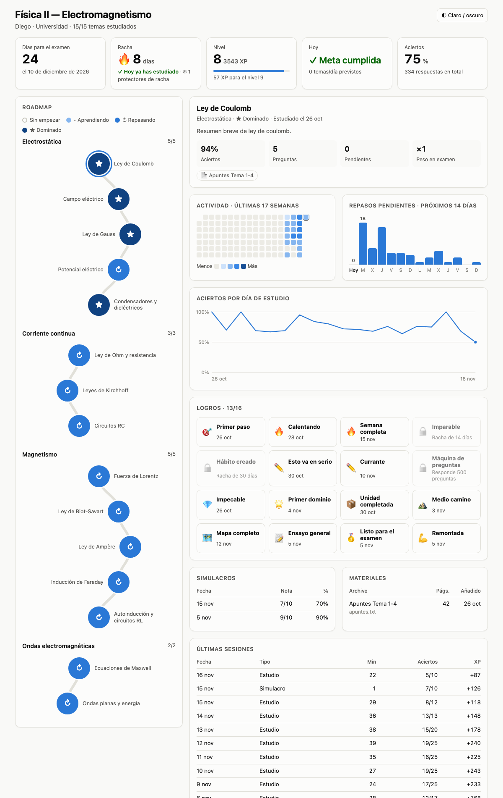

# Learn Everything

**English** · [Español](README.es.md)

A Claude Code plugin that prepares you for an exam using **your own materials**. You give it your notes, slides and photos once; it builds a roadmap, plans every day until the exam, explains each topic, tests you, and keeps you coming back with streaks, XP and achievements.



## What it does

- **Reads your materials once.** PDF, Word, PowerPoint, photos of handwritten notes, plain text. Each file is turned into study notes and remembered by its content, so it is never read twice.
- **Builds a roadmap** of units and topics from those materials, weighted by how much each topic matters in the exam.
- **Plans your days.** Tell it the exam date and how many minutes a day you have. It works out how many topics to cover each day, keeps the last days for revision, and re-plans by itself if you miss a day. The exam date is optional.
- **Explains, then tests.** Short interactive explanations taken from your notes, followed by questions: multiple choice, true or false, fill the gap, short answer, open questions, ordering and matching.
- **Brings questions back at the right time** with spaced repetition (SM-2), always before the exam.
- **Mock exams** with no feedback until the end, then a mark and a breakdown by topic.
- **Streak, XP, levels and 16 achievements.**
- **A dashboard** in a single HTML file: roadmap map, countdown, activity, accuracy, upcoming reviews.

Everything stays on your computer.

## Install

Requires [Claude Code](https://claude.com/claude-code) and Python 3.8 or newer. Nothing else to install.

```bash
claude plugin marketplace add DiegoRecover8/learn-everything
claude plugin install learn-everything@learn-everything
```

Restart Claude Code, then type `/learn`.

To try it without installing, clone the repository and run `claude --plugin-dir /path/to/learn-everything`.

## Quick start

```
/learn setup                    your name, level, exam, date, minutes per day
/learn add ~/Documents/physics  a file, several files, or a whole folder
/learn                          today's session
```

After that, `/learn` every day is all you need. When you open Claude Code you will see where you stand:

```
[Learn Everything] 📚 Physics II — 24 days to the exam
[Learn Everything] 🔥 Streak: 8 days · ⭐ Level 8
[Learn Everything] 📅 Today: 14 reviews + 1 new topic — run /learn
```

## Commands

There is one command. What follows it decides the action.

| Command | What it does |
|---|---|
| `/learn` | Does what today needs: setup, adding materials, or the study session |
| `/learn setup` | Create a new exam, or change your profile or exam settings |
| `/learn add <path>` | Load materials and build or extend the roadmap |
| `/learn exam` | Mock exam |
| `/learn dashboard` | Build and open the dashboard |
| `/learn data` | List or switch exams, back up, export, restore, delete |

You can also just say it: "test me on unit 2", "I have new slides", "how am I doing?".

If another plugin also has a `/learn` command, use the full name: `/learn-everything:learn`.

## How it works

**A session** has three parts: review the questions due today, learn the next topic on the roadmap, and practise it with new questions. At the end you see your score, the XP you earned, your streak and what comes tomorrow.

**The plan.** With an exam date, the topics left are spread over the days left, keeping about the last fifth (at least two days) for revision and mock exams. Without a date, it goes at a steady pace based on your daily minutes. If the plan needs more per day than your time allows, it tells you.

**Reviews.** Each answer is graded from 0 to 5. A good answer pushes the question further away (1 day, 6 days, then longer each time); a bad one brings it back tomorrow. As the exam gets close, intervals are shortened so every question is seen again in time.

**Topic status** goes from not started to learning, reviewing and mastered, according to how you answer its questions. It can go down again if you start failing them.

**Streak.** A day counts when you record at least one session. Every 7 days in a row you earn a streak freeze (up to 2), which covers one missed day automatically.

**XP.** up to 10 per correct answer, 2 for a wrong one, 20 per topic studied, 30 for meeting the daily goal, 50 per mock exam.

## Your data

Everything is stored as plain files in `~/learn-everything/` (set `LEARN_EVERYTHING_HOME` to use another folder):

```
profile.json            you: XP, streak, achievements (shared by all exams)
<exam>/exam.json        exam settings and roadmap
<exam>/cards.json       questions and their review schedule
<exam>/log.jsonl        one line per session
<exam>/sources/         study notes made from your materials
<exam>/dashboard.html   the dashboard
```

- Your original files are never modified or copied; only the notes made from them are kept.
- A backup is taken before every change (the last 10 are kept in `.backups/`).
- `/learn data` exports an exam to a zip, restores it on another computer, or deletes it. Deleted exams go to `.trash/`, so a mistake can be undone.
- To remove everything, delete the `~/learn-everything/` folder.

## Supported files

| Type | Notes |
|---|---|
| PDF | Long documents are read in page ranges |
| DOCX, PPTX | Text, tables, speaker notes and embedded images |
| JPG, PNG, WEBP, GIF | Photos of notes, whiteboards, textbook pages |
| TXT, MD, CSV | Read as they are |

Scanned PDFs and photos are read directly by Claude, so no OCR tool is needed. Very blurred pages may be skipped; the plugin tells you which ones.

## Project layout

```
.claude-plugin/        plugin and marketplace manifests
skills/learn/          the skill: SKILL.md plus one guide per action
scripts/le.py          the data engine (Python standard library only)
scripts/dashboard_template.html
hooks/hooks.json       the status lines shown when Claude Code starts
tests/test_le.py       python3 -m unittest discover -s tests
```

The split is deliberate: Claude teaches and grades; the script does all the bookkeeping and arithmetic, so streaks, schedules and achievements are always computed the same way.

## Credits

Learn Everything builds on ideas from two MIT-licensed projects:

- [learn-anything](https://github.com/ChenChenyaqi/learn-anything) by ChenChenyaqi: the knowledge map, the structure of explanations and the question types.
- [Fluent](https://github.com/m98/fluent) by m98: the Claude Code plugin shape, the session-start status, the streak and SM-2 spaced repetition.

## License

[MIT](LICENSE)
